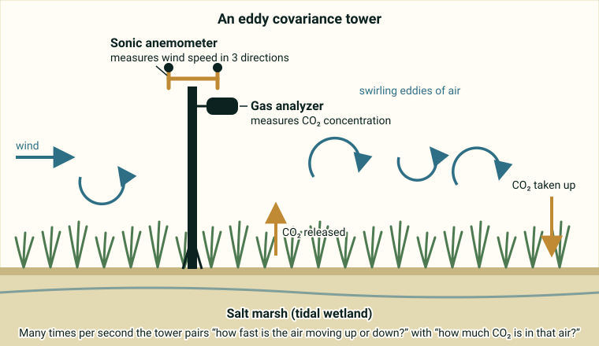
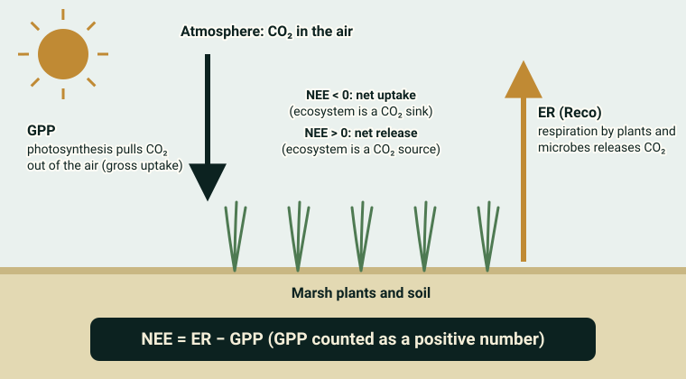
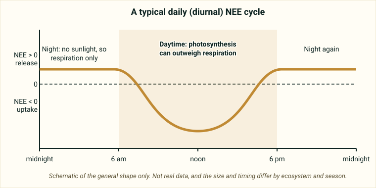

::: {.pager}
[Back to Biogeochemistry](index.qmd)

[Next: SC Wetland Fluxes →](sc-wetland-fluxes.qmd)
:::

## What it is
Science-ready vertical carbon fluxes measured by eddy covariance (EC) over a *Spartina alterniflora* tidal salt marsh on Sapelo Island, Georgia (GCE-LTER). Covers a full decade of continuous measurements.

## Explanation of data

**The big idea.** Plants take carbon dioxide (CO₂) out of the air to build their tissues, and plants and soil microbes put CO₂ back into the air when they respire. This dataset tracks that two-way traffic over a tidal salt marsh on Sapelo Island, Georgia, for about ten years. Coastal marshes like this one are often called **blue carbon** ecosystems because they can store carbon.

**What is a flux?** A *flux* is how much of something crosses a surface, per unit of surface area, per unit of time. Think of counting how many people walk through a doorway each minute. Here the "doorway" is the marsh surface and the "people" are CO₂ molecules, moving *vertically* between the marsh and the air above it.

**How is it measured? Eddy covariance.** Air near the ground is turbulent: it is full of small swirls called *eddies* that carry air up and down. An *eddy covariance* (EC) tower sits above the marsh with two instruments:

- a **sonic anemometer**, which measures wind speed in three directions (including straight up or down) using sound pulses, and
- a **gas analyzer**, which measures how much CO₂ is in the air.

If upward-moving air tends to carry *more* CO₂ than downward-moving air, the marsh is releasing CO₂. If upward air carries *less*, the marsh is taking CO₂ up. The statistical link between vertical wind and CO₂ is called a *covariance*, which is where the method gets its name. The tower mostly "sees" the marsh upwind of it, called the **footprint**. The README says the dataset records what fraction of the footprint was tall, medium or short marsh habitat (it does not define those height classes here, so check the metadata page).

{fig-alt="Cartoon of a tower in a marsh with a sonic anemometer and a gas analyzer at the top and curved arrows showing eddies of air moving CO2 up and down."}

**NEE, GPP and ER (Reco).** The three headline variables fit together like a bank account:

- **GPP (gross primary production)** is the total CO₂ the plants pull in through photosynthesis. It is like your gross paycheck.
- **ER (ecosystem respiration, also written Reco)** is the CO₂ released by plants and soil microbes. It is like your spending.
- **NEE (net ecosystem exchange)** is the net result that the tower actually sees: NEE = ER − GPP (with GPP written as a positive number). It is like your balance change.

**Sign convention.** In this dataset, a **negative NEE means the ecosystem is taking up CO₂** (a net sink), and a positive NEE means it is releasing CO₂ to the atmosphere (a net source).

{fig-alt="Diagram with a downward arrow labeled GPP, an upward arrow labeled ER, and the equation NEE equals ER minus GPP."}

Good to know: a tower measures **NEE** directly. GPP and ER are not measured directly. They are *estimated* by splitting NEE into two pieces, a step called **flux partitioning**. That is why the README suggests comparing methods.

**Daily and seasonal cycles.** A *diurnal cycle* is a pattern that repeats every 24 hours. At night there is no sunlight, so there is no photosynthesis and respiration dominates (NEE is positive). In daylight, photosynthesis usually rises and can outweigh respiration (NEE dips negative). A *seasonal cycle* is the same idea across the year: in many ecosystems uptake is strongest in the growing season. The 30-minute data let you see the daily cycle, while the daily and annual data let you see seasons and yearly totals. Check which pattern your own data actually show.

{fig-alt="Schematic line graph of NEE over 24 hours, positive at night and dipping below zero around noon."}

**Gaps and uncertainty.** Towers sometimes miss data (power loss, bad weather, instrument problems). *Gap-filling* means estimating values for the missing periods. The README mentions comparing gap-filled with observed periods, so look for a column or flag that tells them apart. The dataset also gives **95% confidence intervals**, a range that very likely contains the true value, as an estimate of uncertainty.

**Supporting variables.** The README lists air temperature, humidity, **VPD** and **water-table height**. *Relative humidity* is how much water vapor is in the air compared with the most it could hold at that temperature. *VPD (vapor pressure deficit)* is the gap between those two amounts, so it measures how "thirsty" the air is. *Water-table height* is the level of the water relative to the ground. On a tidal marsh it may be linked to the tides, but the README does not say, so check the metadata.

::: {.callout-note appearance="simple"}
**Not stated in the README:** the units of NEE, GPP and ER, and the exact variable names. Those details are on the [metadata page](https://portal.edirepository.org/nis/mapbrowse?packageid=knb-lter-gce.858.12). Eddy covariance fluxes are commonly reported as an amount of CO₂ (or carbon) per area per time, but confirm before you plot.
:::

### Key terms

| Term | Plain-language meaning | Typical units |
|---|---|---|
| Flux | Amount of something crossing a surface per area per time | Not given in README |
| Eddy covariance (EC) | Tower method that links vertical wind to gas concentration to get a flux | n/a |
| Sonic anemometer | Instrument that measures 3-D wind using sound | n/a |
| Gas analyzer | Instrument that measures CO₂ in the air | n/a |
| NEE | Net CO₂ exchange; NEE = ER − GPP; negative means net uptake | Not given in README |
| GPP | Total CO₂ taken up by photosynthesis | Not given in README |
| ER (Reco) | CO₂ released by plant and microbe respiration | Not given in README |
| Footprint | The patch of marsh upwind that the tower measures | n/a |
| Diurnal cycle | Pattern that repeats every 24 hours | 30-minute data |
| Gap-filling | Estimating values for missing measurements | n/a |
| 95% confidence interval | Range likely to contain the true value | Same as the variable |
| VPD | How "thirsty" the air is (gap between water vapor held and the most it could hold) | Not given in README |
| Water-table height | Level of the water relative to the ground | Not given in README |

## Source and access

- **EDI package ID:** `knb-lter-gce.858.12`
- **Metadata page:** [https://portal.edirepository.org/nis/mapbrowse?packageid=knb-lter-gce.858.12](https://portal.edirepository.org/nis/mapbrowse?packageid=knb-lter-gce.858.12)
- **DOI:** [https://doi.org/10.6073/pasta/796a1d1461efd426a3b5d3c7d8109eda](https://doi.org/10.6073/pasta/796a1d1461efd426a3b5d3c7d8109eda)
- **Original README:** [Biogeochem_1_GCE_EddyCovariance_README.md](https://github.com/EAES-380/2026-Final-Project-Data-Options/blob/main/Biogeochem_1_GCE_EddyCovariance_README.md)

::: {.callout-note appearance="simple"}
**Note on access (from the course README):** Most EDI datasets can be downloaded directly from the metadata page (or via the generated R/Python code). Some require a free EDI access key for scripted downloads. Check the “Accessing Data” documentation on the EDI site if you encounter authentication prompts.
:::

## Variables and contents
- 30-minute, daily, and annual net ecosystem exchange (NEE), ecosystem respiration (ER), and gross primary production (GPP)
- Uncertainty estimates (95% confidence intervals)
- Supporting biophysical variables (air temperature, humidity, VPD, water-table height, etc.)
- Habitat composition of the flux footprint (tall/medium/short marsh)

## Temporal & spatial coverage
- **Time:** 2014–2024
- **Location:** Western Sapelo Island, Georgia, USA (Duplin River / Barn Creek marsh)

## Why this dataset is useful for final projects
Students can explore seasonal and interannual patterns in coastal blue-carbon fluxes, relationships between water-table dynamics and carbon exchange, or gap-filling and flux-partitioning methods. The processed products are relatively ready for analysis in R or Python.

## Suggested questions and analyses
- Seasonal and annual carbon budgets
- Response of NEE/GPP to water-table height or temperature
- Comparison of gap-filled vs. observed periods

## Using this dataset in your project

::: {.project-link}
Thinking about choosing this dataset? Your **proposal** needs a description of the data (what each row is, the variables and a data dictionary), a first exploratory figure, and one question with a possible method. The [Proposal page](../project-guide/proposal.qmd) has a one-page template, and the [Project guide](../project-guide/index.qmd) summarizes everything due. Before you commit, check that this dataset gives you at least 50 rows and at least 10 variables, including categorical, discrete numerical and continuous numerical variables, and that you can load it into R.
:::

---

::: {.pager}
[Back to Biogeochemistry](index.qmd)

[Next: SC Wetland Fluxes →](sc-wetland-fluxes.qmd)
:::
