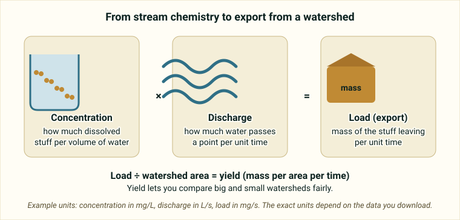

::: {.pager}
[← Previous: SC Wetland Fluxes](sc-wetland-fluxes.qmd)

[Back to Biogeochemistry](index.qmd)
:::

## What it is
A harmonized synthesis of daily streamflow, stream chemistry, precipitation, and watershed attributes from >200 small watersheds across LTER, CZO/CZNet, NEON, and other networks.

## Explanation of data

**The big idea.** A **watershed** is all the land that drains to one point on a stream, like a bowl that funnels rain to a single drain. MacroSheds gathers measurements from more than 200 small watersheds across the United States and puts them in one consistent format (the README calls this *harmonized*). The data come from several research networks: **LTER** (Long Term Ecological Research), **CZO/CZNet** (Critical Zone Observatories) and **NEON** (National Ecological Observatory Network).

**What is in it?** For each watershed you can find:

- **Discharge:** how much water flows past a point in the stream per unit of time. The README says this is daily.
- **Solutes and chemistry:** substances dissolved in the water, such as ions and nutrients (the README says "multiple ions and nutrients").
- **Precipitation and precipitation chemistry** where available.
- **Watershed attributes:** facts about the land, such as climate, geology, terrain, vegetation and land cover. The README says they are aligned with *CAMELS-style* predictors, meaning they follow the format of a well-known set of watershed descriptors.

**Concentration versus load.** A *concentration* is how much of a dissolved substance is in a given volume of water, like how strong a drink is. A *load* (also called *export* or *flux*) is how much of that substance leaves the watershed over a period of time. Load depends on both concentration and discharge: a strong drink in a tiny cup carries less than a weak drink in a huge bucket. Dividing the load by watershed area gives a *yield*, which lets you compare large and small watersheds fairly. The README suggests studying *nutrient export or retention*: export is what leaves in the stream, and retention is what the watershed holds back (for example in plants and soil).

{fig-alt="Three cards showing concentration, multiplied by discharge, equals load, with a note that dividing by watershed area gives yield."}

**Weathering.** The README also mentions *weathering rates*. Weathering is the slow breakdown of rock, which releases dissolved ions into water, so stream chemistry can carry a fingerprint of the local geology.

**How to start.** Because the dataset is large and varies by site (time spans differ by watershed), the README points to an **R package** and a **dashboard** that make it easier to pick sites and download them. Start with a few watersheds rather than all 200.

::: {.callout-note appearance="simple"}
**Not stated in the README:** which specific solutes are included, the units, and which watersheds have the longest records. Use the [metadata page](https://portal.edirepository.org/nis/mapbrowse?packageid=edi.1262.2), the [dashboard](https://macrosheds.org) and the [data paper](https://aslopubs.onlinelibrary.wiley.com/doi/full/10.1002/lol2.10325) for details.
:::

### Key terms

| Term | Plain-language meaning | Typical units |
|---|---|---|
| Watershed | All the land that drains to one point on a stream | Area (see attributes) |
| Discharge | Volume of water passing a point in the stream per time | Not given in README (daily values) |
| Solute | A substance dissolved in water | n/a |
| Concentration | Amount of a solute per volume of water | Not given in README |
| Load / export / flux | Mass of a solute leaving the watershed per time | Not given in README |
| Yield | Load divided by watershed area | Not given in README |
| Retention | Nutrient held back in the watershed instead of leaving in the stream | n/a |
| Precipitation chemistry | What is dissolved in rain or snow | Not given in README |
| Watershed attributes | Descriptors of climate, geology, terrain, vegetation and land cover | Varies |
| Weathering | Slow breakdown of rock that releases dissolved ions | n/a |
| Harmonized | Put into a common format so sites can be compared | n/a |

## Source and access

- **EDI package ID:** `edi.1262.2`
- **Metadata page:** [https://portal.edirepository.org/nis/mapbrowse?packageid=edi.1262.2](https://portal.edirepository.org/nis/mapbrowse?packageid=edi.1262.2)
- **DOI:** [https://doi.org/10.6073/pasta/5ffad974009ff64d0cfc2183c816790b](https://doi.org/10.6073/pasta/5ffad974009ff64d0cfc2183c816790b)
- **Data paper:** [https://aslopubs.onlinelibrary.wiley.com/doi/full/10.1002/lol2.10325](https://aslopubs.onlinelibrary.wiley.com/doi/full/10.1002/lol2.10325)
- **Dashboard:** [https://macrosheds.org](https://macrosheds.org)
- **R package:** [https://github.com/MacroSHEDS/macrosheds](https://github.com/MacroSHEDS/macrosheds)
- **Original README:** [Biogeochem_3_MacroSheds_README.md](https://github.com/EAES-380/2026-Final-Project-Data-Options/blob/main/Biogeochem_3_MacroSheds_README.md)

::: {.callout-note appearance="simple"}
**Note on access (from the course README):** Most EDI datasets can be downloaded directly from the metadata page (or via the generated R/Python code). Some require a free EDI access key for scripted downloads. Check the “Accessing Data” documentation on the EDI site if you encounter authentication prompts.
:::

## Variables and contents
- Daily time series of discharge and solute chemistry (multiple ions and nutrients)
- Precipitation and precipitation chemistry where available
- Comprehensive watershed attributes (climate, geology, terrain, vegetation, land cover) aligned with CAMELS-style predictors

## Temporal & spatial coverage
- **Time:** Multi-decadal for many sites (varies by watershed)
- **Location:** Primarily United States, multiple ecoregions

## Why this dataset is useful for final projects
Excellent for comparative watershed biogeochemistry. Students can examine nutrient retention, weathering rates, or climate–biogeochemistry relationships across a wide range of sites. The R package and dashboard lower the barrier to access.

## Suggested questions and analyses
- Cross-site comparison of nutrient export or retention
- Relationships between watershed attributes and stream chemistry
- Long-term trends in solute concentrations or loads

## Using this dataset in your project

::: {.project-link}
Thinking about choosing this dataset? Your **proposal** needs a description of the data (what each row is, the variables and a data dictionary), a first exploratory figure, and one question with a possible method. The [Proposal page](../project-guide/proposal.qmd) has a one-page template, and the [Project guide](../project-guide/index.qmd) summarizes everything due. Before you commit, check that this dataset gives you at least 50 rows and at least 10 variables, including categorical, discrete numerical and continuous numerical variables, and that you can load it into R.
:::

---

::: {.pager}
[← Previous: SC Wetland Fluxes](sc-wetland-fluxes.qmd)

[Back to Biogeochemistry](index.qmd)
:::
