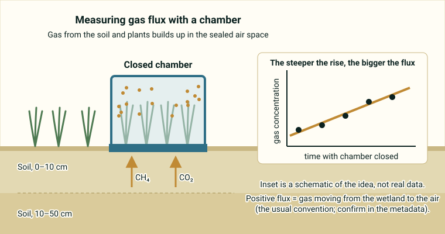

::: {.pager}
[← Previous: GCE Eddy Covariance](gce-eddy-covariance.qmd)

[Back to Biogeochemistry](index.qmd)

[Next: MacroSheds →](macrosheds.qmd)
:::

## What it is
Paired measurements of methane (CH₄) and carbon dioxide (CO₂) fluxes and soil biogeochemical properties from a tidal salt marsh and an impounded brackish wetland in Georgetown County, South Carolina (2022–2023).

## Explanation of data

**The big idea.** Wetland soils hold a lot of carbon, and they can release two greenhouse gases: **carbon dioxide (CO₂)** and **methane (CH₄)**. This dataset pairs measurements of those gas fluxes with measurements of the soil beneath, so you can ask *why* some spots release more gas than others. The data come from two kinds of coastal wetland in Georgetown County, South Carolina, measured about monthly in 2022–2023: a **tidal salt marsh** and an **impounded brackish wetland**.

- *Tidal salt marsh:* flooded by ocean tides, so the water is salty.
- *Impounded wetland:* a wetland where a berm or dike holds water in, which changes how often and how deeply it floods. *Brackish* water is in between fresh and ocean water in saltiness.

**What is a flux, and what is a chamber?** A *flux* is how much gas moves across a surface per unit area per unit time. To measure it here, researchers use **chambers**: closed boxes placed over the ground. Gas that leaks out of the soil and plants builds up inside the sealed space, and the *rate of increase* in concentration tells you the flux. A steeper rise means a larger flux. In the usual convention a positive flux is gas going from the wetland into the air (confirm this in the metadata).

{fig-alt="Cartoon of a sealed chamber on marsh soil with arrows for methane and carbon dioxide and a small graph of rising gas concentration over time."}

The README names three chamber types: **whole-plant**, **plant-adjacent** and **non-vegetated**. It does not define them, so read the metadata before you compare them. The general idea is to separate the effect of plants from the effect of bare soil. Many wetland plants can also move gas between the soil and the air through their stems, which is one reason plants matter for methane.

**Soil measurements.** Soil cores were taken at two depths (0–10 cm and 10–50 cm). The README lists these variables:

- **Carbon (C) and nitrogen (N) concentrations** and the **C:N ratio**. C:N is the amount of carbon relative to nitrogen. It is often used as a rough sign of how easily microbes can break down the organic matter.
- **Moisture** (how wet the soil is) and **pH** (how acidic or basic it is).
- **Conductivity:** how well the soil water carries electricity. It is usually a stand-in for how salty the water is, but check the metadata.
- **Organic matter:** the part of the soil made from once-living material.
- **Root biomass:** the weight of roots in the soil.
- **mcrA gene copy numbers:** *mcrA* is a gene that **methanogens** (microbes that produce methane) use. Counting its copies is a way to estimate how many methane-producing microbes are present.

::: {.callout-note appearance="simple"}
**Not stated in the README:** the units, the exact chamber method, and how chamber and soil measurements are matched in time and place. Check the [metadata page](https://portal.edirepository.org/nis/mapbrowse?packageid=edi.1828.3) before you combine tables.
:::

### Key terms

| Term | Plain-language meaning | Typical units |
|---|---|---|
| CH₄ (methane) | A potent greenhouse gas made by microbes in oxygen-poor soils | Not given in README |
| CO₂ | Carbon dioxide, the main carbon greenhouse gas | Not given in README |
| Flux | Gas moving across a surface per area per time | Not given in README |
| Chamber | A closed box placed over the ground to catch emitted gas | n/a |
| Tidal salt marsh | Coastal wetland flooded by ocean tides | n/a |
| Impounded wetland | Wetland where a berm or dike holds water in | n/a |
| Brackish | Salinity between fresh water and seawater | n/a |
| C:N ratio | Carbon relative to nitrogen in the soil | Ratio (no units) |
| Conductivity | How well soil water conducts electricity (often a salinity proxy) | Not given in README |
| Organic matter | Soil material from once-living things | Not given in README |
| mcrA gene copies | A count that estimates how many methane-making microbes are present | Copies (see metadata) |
| Core depths | Soil samples at 0–10 cm and 10–50 cm | cm |

## Source and access

- **EDI package ID:** `edi.1828.3`
- **Metadata page:** [https://portal.edirepository.org/nis/mapbrowse?packageid=edi.1828.3](https://portal.edirepository.org/nis/mapbrowse?packageid=edi.1828.3)
- **DOI:** [https://doi.org/10.6073/pasta/08bab7404a446ab8c3d6607eb796aed8](https://doi.org/10.6073/pasta/08bab7404a446ab8c3d6607eb796aed8)
- **Original README:** [Biogeochem_2_SC_WetlandFluxes_README.md](https://github.com/EAES-380/2026-Final-Project-Data-Options/blob/main/Biogeochem_2_SC_WetlandFluxes_README.md)

::: {.callout-note appearance="simple"}
**Note on access (from the course README):** Most EDI datasets can be downloaded directly from the metadata page (or via the generated R/Python code). Some require a free EDI access key for scripted downloads. Check the “Accessing Data” documentation on the EDI site if you encounter authentication prompts.
:::

## Variables and contents
- Soil cores (0–10 cm and 10–50 cm): C and N concentrations, C:N ratios, moisture, pH, conductivity, organic matter, root biomass, mcrA gene copy numbers
- Chamber fluxes: whole-plant, plant-adjacent, and non-vegetated chambers for CH₄ and CO₂

## Temporal & spatial coverage
- **Time:** 2022–2023 (approximately monthly)
- **Location:** Georgetown County, South Carolina, USA

## Why this dataset is useful for final projects
Ideal for students interested in plant–microbe–soil interactions controlling wetland greenhouse-gas emissions. Combines process measurements (fluxes) with mechanistic soil variables.

## Suggested questions and analyses
- Relationships between plant presence, soil properties, and CH₄ fluxes
- Comparison of salt marsh vs. impounded wetland
- Drivers of spatial and temporal variability in fluxes

## Using this dataset in your project

::: {.project-link}
Thinking about choosing this dataset? Your **proposal** needs a description of the data (what each row is, the variables and a data dictionary), a first exploratory figure, and one question with a possible method. The [Proposal page](../project-guide/proposal.qmd) has a one-page template, and the [Project guide](../project-guide/index.qmd) summarizes everything due. Before you commit, check that this dataset gives you at least 50 rows and at least 10 variables, including categorical, discrete numerical and continuous numerical variables, and that you can load it into R.
:::

---

::: {.pager}
[← Previous: GCE Eddy Covariance](gce-eddy-covariance.qmd)

[Back to Biogeochemistry](index.qmd)

[Next: MacroSheds →](macrosheds.qmd)
:::
