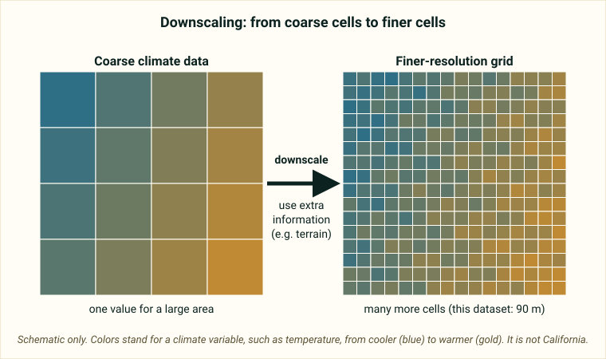

::: {.pager}
[← Previous: Niwot Ridge D1](niwot-ridge-d1.qmd)

[Back to Climate](index.qmd)
:::

## What it is
High-resolution (90 m) downscaled climate grids for California covering a variety of bioclimatic variables derived from historical climate data (1971–2000 normal period).

## Explanation of data

**The big idea.** Climate is usually measured at weather stations, which are single points on a map. To study climate across a whole state you need values *everywhere*. This dataset gives you that as a **grid**: California is divided into square cells, each **90 m** on a side, and every cell has a value for each climate variable. Think of a photo made of pixels, where each pixel stores a temperature or a rainfall amount instead of a color.

**What does "downscaled" mean?** Large-scale climate data often come in coarse cells many kilometers wide. *Downscaling* uses extra information, such as terrain or station measurements, to estimate climate at a finer scale, so you can tell the cool valley floor from the sunny ridge. The README does not describe the downscaling method, so see the metadata for how it was done.

{fig-alt="A four by four grid of large colored cells becomes a sixteen by sixteen grid of small colored cells, with an arrow labeled downscale."}

**Bioclimatic variables.** The README says the grids contain *bioclimatic variables*: temperature, precipitation and *derived indices* (numbers computed from the basic ones). Bioclimatic variables are summaries designed to matter for living things, for example the average yearly temperature, how much it rains in the driest part of the year, or how much the temperature varies through the year. These are examples of the idea: the exact list of variables is on the metadata page.

**A climate normal.** The README gives the period **1971–2000**. A *climate normal* is the average over 30 years, so this dataset describes "typical" historical California climate, not a single year. It is a snapshot in time, not a time series, so questions about year-to-year change or trends do not fit this dataset.

**Historical, not projected.** The README describes historical data, so this dataset is not a future projection. (Some downscaled climate datasets are built from *global climate models*, or GCMs, which simulate Earth's climate, and from *scenarios* of future emissions. Check the metadata for what was used here; the README does not say.)

**Working with gridded data.** Gridded data is not a normal spreadsheet. It often comes as *raster* files, which are images where each cell holds a value, and you need an R package that reads rasters to load it (the README does not state the file format; check before you commit). You can convert a raster to a table with one row per cell, which is useful because a project needs at least 50 rows and 10 variables. Cells that are next to each other tend to be similar, which matters when you apply statistics that assume independent observations.

::: {.callout-note appearance="simple"}
**Not stated in the README:** the file format, the list of variables, the units and the DOI (the README says to check the [metadata page](https://portal.edirepository.org/nis/mapbrowse?packageid=edi.167.1)).
:::

### Key terms

| Term | Plain-language meaning | Typical units |
|---|---|---|
| Grid / raster | A map made of square cells, each holding a value | Cell size 90 m |
| Resolution | The size of each cell; smaller cells show more detail | 90 m |
| Downscaling | Estimating climate at a finer scale from coarser data | n/a |
| Bioclimatic variable | A temperature or rainfall summary chosen to matter for living things | Not given in README |
| Derived index | A number computed from other climate variables | Not given in README |
| Climate normal | A 30-year average of climate | 1971–2000 here |
| GCM (global climate model) | A computer model of Earth's climate; often a starting point for downscaling | n/a (see metadata) |
| Spatial pattern | How a variable changes from place to place | n/a |

## Source and access

- **EDI package ID:** `edi.167.1`
- **Metadata page:** [https://portal.edirepository.org/nis/mapbrowse?packageid=edi.167.1](https://portal.edirepository.org/nis/mapbrowse?packageid=edi.167.1)
- **DOI:** (check metadata page)
- **Original README:** [Climate_3_California_Downscaled_README.md](https://github.com/EAES-380/2026-Final-Project-Data-Options/blob/main/Climate_3_California_Downscaled_README.md)

::: {.callout-note appearance="simple"}
**Note on access (from the course README):** Most EDI datasets can be downloaded directly from the metadata page (or via the generated R/Python code). Some require a free EDI access key for scripted downloads. Check the “Accessing Data” documentation on the EDI site if you encounter authentication prompts.
:::

## Variables and contents
- Gridded bioclimatic variables (temperature, precipitation, and derived indices) at 90 m resolution
- Suitable for spatial analysis and ecological modeling

## Temporal & spatial coverage
- **Time:** 1971–2000 (climate normal)
- **Location:** California, USA

## Why this dataset is useful for final projects
Ideal for students interested in spatial climate patterns, downscaling methods, or linking climate to species distributions or ecosystem properties across California’s diverse landscapes.

## Suggested questions and analyses
- Spatial patterns of temperature or precipitation across ecoregions
- Comparison of bioclimatic variables with ecological datasets
- Uncertainty or validation exercises (if paired with station data)

## Using this dataset in your project

::: {.project-link}
Thinking about choosing this dataset? Your **proposal** needs a description of the data (what each row is, the variables and a data dictionary), a first exploratory figure, and one question with a possible method. The [Proposal page](../project-guide/proposal.qmd) has a one-page template, and the [Project guide](../project-guide/index.qmd) summarizes everything due. Before you commit, check that this dataset gives you at least 50 rows and at least 10 variables, including categorical, discrete numerical and continuous numerical variables, and that you can load it into R.
:::

---

::: {.pager}
[← Previous: Niwot Ridge D1](niwot-ridge-d1.qmd)

[Back to Climate](index.qmd)
:::
