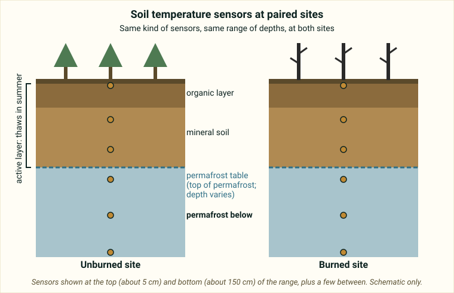

::: {.pager}
[← Previous: Bonanza Creek Boreholes](bnz-boreholes.qmd)

[Back to Geophysics](index.qmd)

[Next: VCR Seismic Stratigraphy →](vcr-seismic-stratigraphy.qmd)
:::

## What it is
Hourly soil temperature measurements at depths from 5 to 150 cm at paired burned and unburned sites in Interior Alaska. Designed to examine the effects of climate and wildfire on near-surface permafrost thermal regimes.

## Explanation of data

**The big idea.** Wildfire can burn trees and the **organic layer** (moss and partly decayed plants) on the forest floor. That organic layer works like a blanket that insulates the ground. Researchers want to know how losing it, along with climate, changes the temperature of the soil and the **permafrost** underneath. *Permafrost* is ground that stays at or below 0 °C for at least two years in a row. Above it is the **active layer**, the top layer that thaws in summer and refreezes in winter.

{fig-alt="Two side-by-side soil cross-sections, one with green trees and one with burned trunks, each with temperature sensors at several depths and a dashed line for the permafrost table."}

**How the study is designed.** The README describes *paired burned and unburned sites*. *Paired* means each burned site has a nearby unburned comparison site, so that differences are more likely to be due to the fire than to differences in the landscape. This is a common way to study an effect when you cannot run a controlled experiment. The README says the data are **hourly soil temperatures** at **depths from 5 to 150 cm**, from **2013 to 2018**, in Interior Alaska. That is a *time series at many depths*: one set of columns per depth, or one row per depth and time, so check how your data file is organized.

**What do you compare?** The README suggests three ideas:

- *Temperature profiles at burned vs. unburned sites:* compare temperature versus depth for the same date or season.
- *Freeze–thaw dynamics:* *freeze–thaw* is the seasonal change between frozen and thawed soil. You can see it when soil temperature at a given depth crosses 0 °C.
- *Depth-dependent warming rates:* does the soil warm faster near the surface or deeper down, and does that differ between burned and unburned sites?

**What the README does not tell you.** It does not say how severe each fire was (*burn severity* is how much of the vegetation and organic layer was consumed), how long ago each site burned, or what the units are (temperature is almost certainly in degrees Celsius, but verify). Do not assume the burned sites are warmer or colder: test it with the data.

**Hourly data.** With one record per hour, there are 24 per day, which is a lot of data. Plan whether to average to daily values (for example, daily mean at each depth) so that graphs are readable.

::: {.callout-note appearance="simple"}
**Not stated in the README:** units, site locations, burn severity and years since fire. Check the [metadata page](https://portal.edirepository.org/nis/mapbrowse?packageid=knb-lter-bnz.717.2).
:::

### Key terms

| Term | Plain-language meaning | Typical units |
|---|---|---|
| Wildfire | An uncontrolled fire in a natural area | n/a |
| Permafrost | Ground at or below 0 °C for at least two years | Temperature (verify unit) |
| Active layer | Top layer that thaws in summer and refreezes in winter | Depth in cm |
| Organic layer | Moss and partly decayed plants on top of the mineral soil; insulates the ground | n/a |
| Paired sites | A burned site matched with a nearby unburned site for comparison | n/a |
| Soil temperature | How warm the soil is at a given depth | Not given in README |
| Depth | Distance below the ground surface | 5–150 cm |
| Freeze–thaw | The seasonal switch between frozen and thawed soil | n/a |
| Hourly data | One measurement per hour | 1 hour |

## Source and access

- **EDI package ID:** `knb-lter-bnz.717.2`
- **Metadata page:** [https://portal.edirepository.org/nis/mapbrowse?packageid=knb-lter-bnz.717.2](https://portal.edirepository.org/nis/mapbrowse?packageid=knb-lter-bnz.717.2)
- **DOI:** [https://doi.org/10.6073/pasta/275492a4d552c5b4612f1aa42d88bc46](https://doi.org/10.6073/pasta/275492a4d552c5b4612f1aa42d88bc46)
- **Original README:** [Geophysics_2_AK_Wildfire_Permafrost_README.md](https://github.com/EAES-380/2026-Final-Project-Data-Options/blob/main/Geophysics_2_AK_Wildfire_Permafrost_README.md)

::: {.callout-note appearance="simple"}
**Note on access (from the course README):** Most EDI datasets can be downloaded directly from the metadata page (or via the generated R/Python code). Some require a free EDI access key for scripted downloads. Check the “Accessing Data” documentation on the EDI site if you encounter authentication prompts.
:::

## Variables and contents
- Hourly soil temperature at multiple depths
- Burned vs. unburned paired sites

## Temporal & spatial coverage
- **Time:** 2013–2018
- **Location:** Interior Alaska

## Why this dataset is useful for final projects
Students can investigate how wildfire alters the thermal structure of the active layer and upper permafrost—an important geophysical and ecological process in boreal and Arctic systems.

## Suggested questions and analyses
- Differences in soil temperature profiles between burned and unburned sites
- Seasonal freeze–thaw dynamics
- Depth-dependent warming rates

## Using this dataset in your project

::: {.project-link}
Thinking about choosing this dataset? Your **proposal** needs a description of the data (what each row is, the variables and a data dictionary), a first exploratory figure, and one question with a possible method. The [Proposal page](../project-guide/proposal.qmd) has a one-page template, and the [Project guide](../project-guide/index.qmd) summarizes everything due. Before you commit, check that this dataset gives you at least 50 rows and at least 10 variables, including categorical, discrete numerical and continuous numerical variables, and that you can load it into R.
:::

---

::: {.pager}
[← Previous: Bonanza Creek Boreholes](bnz-boreholes.qmd)

[Back to Geophysics](index.qmd)

[Next: VCR Seismic Stratigraphy →](vcr-seismic-stratigraphy.qmd)
:::
