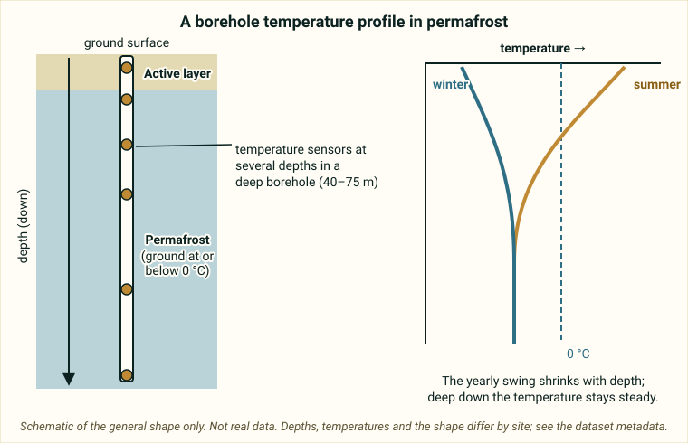

::: {.pager}
[Back to Geophysics](index.qmd)

[Next: AK Wildfire & Permafrost →](ak-wildfire-permafrost.qmd)
:::

## What it is
Temperature profiles from deep boreholes (40–75 m) in permafrost near Fairbanks, Alaska. Part of long-term monitoring of the active layer and permafrost thermal regime.

## Explanation of data

**The big idea.** In cold regions like Interior Alaska, the ground can stay frozen for years. **Permafrost** is ground (soil, rock or ice) that stays at or below 0 °C for at least two years in a row. Above it is the **active layer**, the top layer of ground that thaws in summer and refreezes in winter. Permafrost matters because thawing can change the landscape, release stored carbon, and damage roads and buildings.

{fig-alt="Schematic with a ground column and a borehole with sensors, and a graph of temperature against depth where summer and winter curves come together deeper down."}

**What is a borehole?** A *borehole* is a narrow hole drilled into the ground. Here, **temperature sensors are placed at several depths** down the hole, so that you can measure how temperature changes with depth over time. The README says these boreholes are **40–75 m deep**, near Fairbanks, Alaska, and that the record runs from **2009 to 2021**. It also includes *surface temperature* data, so you can compare the top of the ground to the deep ground.

**Why measure temperature in the ground?** Heat from the surface slowly soaks downward. The yearly warm and cold swings are large near the surface and get smaller with depth, like ripples fading as they spread across a pond. Deep down, the temperature changes very slowly, so it is a sensitive record of long-term warming. This is why the README suggests comparing *surface and deep temperatures* and looking at *long-term warming trends*.

**Temperature profile.** A *profile* is temperature plotted against depth at one moment (or averaged over a period). The 0 °C line is important: ground colder than 0 °C is frozen, and ground warmer than 0 °C is thawed. (Salty or fine-grained soils can freeze or thaw slightly away from 0 °C, which is a detail you can ignore for this project.)

**Active-layer thickness and thaw depth.** The README suggests estimating *thaw depth* or *active-layer thickness*, which means how deep the 0 °C line moves down in summer. With sensors at only certain depths, you would estimate this by looking at where the temperature crosses 0 °C between sensors, so explain your method.

**Mind the sites and sensors.** The README says the sites span *a range of permafrost and environmental conditions*, so compare sites carefully. It does not state the units (temperature is almost certainly in degrees Celsius, but verify), the sensor depths or the measurement frequency.

::: {.callout-note appearance="simple"}
**Not stated in the README:** exact depths, units, sampling interval and site descriptions. Check the [metadata page](https://portal.edirepository.org/nis/mapbrowse?packageid=knb-lter-bnz.792.2).
:::

### Key terms

| Term | Plain-language meaning | Typical units |
|---|---|---|
| Permafrost | Ground that stays at or below 0 °C for at least two years | Temperature (verify unit) |
| Active layer | Top layer that thaws in summer and refreezes in winter | Depth (verify unit) |
| Borehole | A narrow drilled hole used to place sensors at depth | 40–75 m deep here |
| Temperature profile | Temperature plotted against depth | Not given in README |
| Thaw depth | How deep thawing reaches in summer | Not given in README |
| Thermal regime | The pattern of ground temperature through time | n/a |
| Surface temperature | Temperature at the ground surface | Not given in README |
| Warming trend | A steady rise in temperature over years | n/a |

## Source and access

- **EDI package ID:** `knb-lter-bnz.792.2`
- **Metadata page:** [https://portal.edirepository.org/nis/mapbrowse?packageid=knb-lter-bnz.792.2](https://portal.edirepository.org/nis/mapbrowse?packageid=knb-lter-bnz.792.2)
- **DOI:** [https://doi.org/10.6073/pasta/b70120f14a18cd4c6f08daaff9797bf5](https://doi.org/10.6073/pasta/b70120f14a18cd4c6f08daaff9797bf5)
- **Original README:** [Geophysics_1_BNZ_Boreholes_README.md](https://github.com/EAES-380/2026-Final-Project-Data-Options/blob/main/Geophysics_1_BNZ_Boreholes_README.md)

::: {.callout-note appearance="simple"}
**Note on access (from the course README):** Most EDI datasets can be downloaded directly from the metadata page (or via the generated R/Python code). Some require a free EDI access key for scripted downloads. Check the “Accessing Data” documentation on the EDI site if you encounter authentication prompts.
:::

## Variables and contents
- Borehole temperature time series at multiple depths
- Surface temperature data
- Sites spanning a range of permafrost and environmental conditions

## Temporal & spatial coverage
- **Time:** 2009–2021
- **Location:** Near Fairbanks, Interior Alaska, USA

## Why this dataset is useful for final projects
Provides geophysical-style subsurface thermal data relevant to permafrost dynamics, climate change impacts on frozen ground, and land–atmosphere interactions in the Arctic. Temperature profiles can be analyzed for active-layer thickness, permafrost temperature trends, and thaw depth.

## Suggested questions and analyses
- Vertical temperature profiles and seasonal thaw depth
- Long-term warming trends in permafrost
- Comparison of surface vs. deep temperatures

## Using this dataset in your project

::: {.project-link}
Thinking about choosing this dataset? Your **proposal** needs a description of the data (what each row is, the variables and a data dictionary), a first exploratory figure, and one question with a possible method. The [Proposal page](../project-guide/proposal.qmd) has a one-page template, and the [Project guide](../project-guide/index.qmd) summarizes everything due. Before you commit, check that this dataset gives you at least 50 rows and at least 10 variables, including categorical, discrete numerical and continuous numerical variables, and that you can load it into R.
:::

---

::: {.pager}
[Back to Geophysics](index.qmd)

[Next: AK Wildfire & Permafrost →](ak-wildfire-permafrost.qmd)
:::
