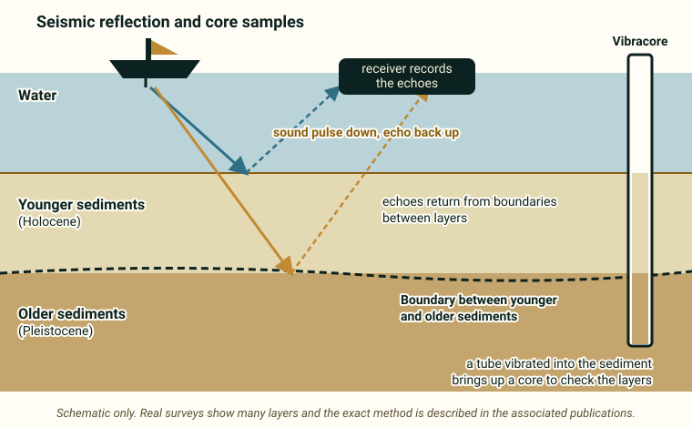

::: {.pager}
[← Previous: AK Wildfire & Permafrost](ak-wildfire-permafrost.qmd)

[Back to Geophysics](index.qmd)
:::

## What it is
Sediment grain-size, organic-matter, and stratigraphic data from vibracores, interpreted together with high-resolution seismic records to reconstruct the pre-transgression landscape and Holocene/Pleistocene boundary on the Virginia Coast Reserve (Hog Island Bay area).

## Explanation of data

**The big idea.** The coast of Virginia is a landscape of barrier islands, marshes and shallow bays. Over thousands of years the sea has risen and the land has shifted. Under the bay floor, layers of sediment record that history, like the layers of a cake. Studying those layers is called **stratigraphy**. This dataset combines **sediment cores** taken near Hog Island Bay with **seismic** information, to reconstruct what the land looked like before the sea flooded it.

**Time words.** Two geologic time words appear in the README:

- **Pleistocene:** the older geologic period (the last "ice ages"), when sea level was generally lower and this area was land.
- **Holocene:** the younger period that began about 11,700 years ago and includes today.

The **Holocene/Pleistocene boundary** is the surface where younger sediments sit on top of older ones. It is a map of the old landscape that was drowned. The README also lists a *300 YBP surface*, where **YBP** means *years before present* (a surface dated to about 300 years ago; see the metadata for how it is defined). **Transgression** means the sea moving landward as sea level rises.

{fig-alt="A boat sends sound pulses down through water to sediment layers. Echoes return from the boundary between younger and older sediments. A tube-shaped core sample is shown beside it."}

**Cores.** The README says the data come from **vibracores**: a long tube is vibrated down into soft sediment and pulled out, giving a column you can look at layer by layer. The README says the cores were collected *prior to 1997*. From the cores you get:

- **Grain size:** how big the particles are, from coarse sand to fine silt and clay. Grain size tells you about the energy of the water that deposited the sediment: fast water leaves coarse grains, calm water leaves fine ones.
- **Organic-matter content:** how much of the sediment is made of once-living material, such as marsh plants.

**Seismic reflection.** The README says the core data are interpreted together with *high-resolution seismic records*. In a seismic-reflection survey, a boat sends **sound pulses** down through the water and the sediment. When the sound reaches a boundary between layers that differ in density or stiffness, part of it is reflected back to a receiver. How long the echo takes to return tells you how deep the boundary is. Cores are used to check what the layers really are. The README says the seismic information is *described in associated publications*, so the dataset itself may not contain raw seismic records. Check what is actually in the data tables.

**Trend surface analysis.** The title includes *trend surface analysis*, a statistical method that fits a smooth surface (like a gently tilted sheet) through scattered measurements, here to show how the depth of a boundary varies across the area. It is a way to map a surface from points. The README also suggests *paleotopography*, the shape of the land surface in the past.

**Expect different kinds of data.** This dataset mixes core measurements (grain size, organic matter) with horizon data (depths of the 300 YBP and Holocene/Pleistocene surfaces) and probably location columns. The README does not give the units, so check the metadata.

::: {.callout-note appearance="simple"}
**Not stated in the README:** column names, units, number of cores and how horizon depths are measured. Check the [metadata page](https://portal.edirepository.org/nis/mapbrowse?packageid=knb-lter-vcr.15.19).
:::

### Key terms

| Term | Plain-language meaning | Typical units |
|---|---|---|
| Stratigraphy | The study of layers of sediment or rock and what they reveal about the past | n/a |
| Vibracore | A tube vibrated into sediment to pull up a core | n/a |
| Grain size | How big the sediment particles are (sand, silt, clay) | Not given in README |
| Organic matter | Material from once-living things in the sediment | Not given in README |
| Holocene | The geologic period from about 11,700 years ago to today | n/a |
| Pleistocene | The older geologic period before the Holocene | n/a |
| Holocene/Pleistocene boundary | The surface where younger sediment sits on older sediment | Depth (see metadata) |
| YBP | Years before present | Years |
| Transgression | Sea moving landward as sea level rises | n/a |
| Seismic reflection | Using echoes of sound to map layers below the surface | n/a |
| Trend surface | A smooth surface fitted through scattered measurements | n/a |
| Paleotopography | The shape of the land surface in the past | n/a |

## Source and access

- **EDI package ID:** `knb-lter-vcr.15.19`
- **Metadata page:** [https://portal.edirepository.org/nis/mapbrowse?packageid=knb-lter-vcr.15.19](https://portal.edirepository.org/nis/mapbrowse?packageid=knb-lter-vcr.15.19)
- **DOI:** [https://doi.org/10.6073/pasta/03c4f7940115a3454958f4c2e997a3a6](https://doi.org/10.6073/pasta/03c4f7940115a3454958f4c2e997a3a6)
- **Original README:** [Geophysics_3_VCR_Seismic_Stratigraphy_README.md](https://github.com/EAES-380/2026-Final-Project-Data-Options/blob/main/Geophysics_3_VCR_Seismic_Stratigraphy_README.md)

::: {.callout-note appearance="simple"}
**Note on access (from the course README):** Most EDI datasets can be downloaded directly from the metadata page (or via the generated R/Python code). Some require a free EDI access key for scripted downloads. Check the “Accessing Data” documentation on the EDI site if you encounter authentication prompts.
:::

## Variables and contents
- Grain-size distributions and organic-matter content from cores
- Stratigraphic horizon data (300 YBP surface and Holocene/Pleistocene boundary)
- Supporting high-resolution seismic information (described in associated publications)

## Temporal & spatial coverage
- **Time:** Core collection prior to 1997; Holocene stratigraphic record
- **Location:** Virginia Coast Reserve, Hog Island Bay, Virginia, USA

## Why this dataset is useful for final projects
Offers a coastal geologic/geophysical dataset focused on sedimentary stratigraphy and sea-level rise history. Students can explore barrier-island evolution, sediment characteristics, or the application of seismic and core data to reconstruct past landscapes.

## Suggested questions and analyses
- Spatial patterns in grain size or organic content
- Reconstruction of paleotopography
- Relationship between stratigraphy and modern coastal processes

## Using this dataset in your project

::: {.project-link}
Thinking about choosing this dataset? Your **proposal** needs a description of the data (what each row is, the variables and a data dictionary), a first exploratory figure, and one question with a possible method. The [Proposal page](../project-guide/proposal.qmd) has a one-page template, and the [Project guide](../project-guide/index.qmd) summarizes everything due. Before you commit, check that this dataset gives you at least 50 rows and at least 10 variables, including categorical, discrete numerical and continuous numerical variables, and that you can load it into R.
:::

---

::: {.pager}
[← Previous: AK Wildfire & Permafrost](ak-wildfire-permafrost.qmd)

[Back to Geophysics](index.qmd)
:::
