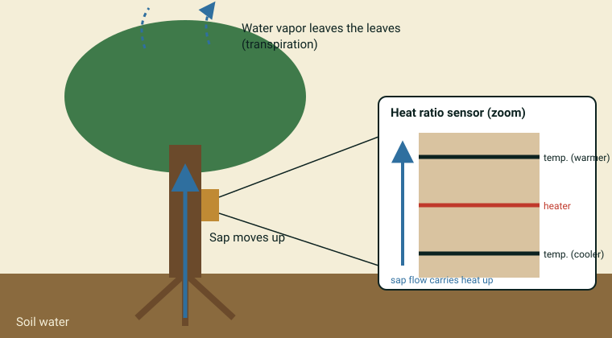

::: {.pager}
[← Previous: MacroSheds](macrosheds.qmd)

[Back to Hydrology](index.qmd)
:::

## What it is
Uncorrected sap velocity measurements from urban trees at five sites in Chicago, Illinois, collected with heat ratio method (HRM) sensors as part of the DOE CROCUS (Community Research on Climate and Urban Science) project. The trees include street trees and trees in urban parks. This dataset is published on the DOE ESS-DIVE / LBNL data repository, not on EDI.

## Explanation of data

**The big idea.** Trees are giant water pumps. Water enters the **roots** from the soil, travels up the trunk as **sap** (in the wood, or *xylem*), and leaves through tiny pores in the leaves as water vapor. That last step is called **transpiration**. It cools the tree and the air around it, which matters a lot in a hot city. Measuring how fast sap moves tells you how much water a tree is using and when.

**How is sap speed measured?** The dataset description says these sensors use the **heat ratio method (HRM)** (ICT International SFM1x sensors). Three thin needles go into the trunk: a **heater** in the middle and a **temperature needle** above and below it. The heater gives a short pulse of heat. If sap is moving upward, it carries more of that heat to the upper needle. The ratio of warming at the two needles is turned into a **sap velocity**, in **cm/hr**.

{fig-alt="Cartoon tree with arrows showing water moving from roots up the trunk to the leaves, and a zoomed sensor with a heater needle between two temperature needles."}

**Inner and outer probes.** Each sensor reports sap velocity from an **inner** and an **outer** measurement point, at different depths in the wood. Sap often moves at different speeds at different depths, so you can compare them.

**Raw data and quality flags.** These are **raw, uncorrected** values. They are *not* corrected for wood anatomy or species differences, so treat them as relative speeds, and be careful comparing absolute numbers between species. Each value has a **quality-control flag** made from 3 "yes/no" checks (a 3-bit code):

- **Physical range:** the value is below −10 or above 60 cm/hr.
- **Step spike:** the value jumps by more than 36 cm/hr from the previous one.
- **Stuck sensor:** more than 10 identical values in a row.

Decide (and explain in your project) how you handle flagged values.

**Urban trees and linked data.** Data were sent wirelessly (LoRaWAN) to **Sage Network** nodes, and each record has a Sage Node ID. The same nodes measured things like air quality and wind speed, published as linked CROCUS datasets (their DOIs are in the data package). That lets you ask how weather affects tree water use.

::: {.callout-note appearance="simple"}
**Not stated in the dataset description:** the exact start and end dates (the title says 2024–2025), the number of trees or sensors at each site, the probe depths, the file names and column names, and how the flag bits are coded. Check the [data package](https://doi.org/10.15485/3013822) and its file-level metadata.
:::

### Key terms

| Term | Plain-language meaning | Typical units |
|---|---|---|
| Sap | Water (with dissolved nutrients) moving up through the wood | n/a |
| Xylem | The water-carrying tissue in wood | n/a |
| Transpiration | Water leaving leaves as vapor | n/a |
| Sap velocity | How fast sap moves up the trunk | cm/hr |
| Heat ratio method (HRM) | Measuring sap speed from how a heat pulse spreads up vs. down | n/a |
| Inner / outer probe | Measurement points at two depths in the wood | n/a |
| DBH | Diameter at breast height: trunk width about 1.3 m above ground | cm |
| QC flag | A code marking values that failed automatic checks | 3-bit code |
| Sage node | A sensor station that collects the wireless data | n/a |
| Diurnal cycle | The day–night pattern (sap is usually faster by day) | n/a |

## Source and access

- **Repository:** DOE ESS-DIVE / LBNL data repository (not EDI)
- **Record page:** [https://www.osti.gov/biblio/3013822](https://www.osti.gov/biblio/3013822)
- **DOI:** [https://doi.org/10.15485/3013822](https://doi.org/10.15485/3013822)
- **Citation:** Berkelhammer, M., Kaludi, B., Lee, J., Negri, C., Collis, S., Muradyan, P., et al. (2026). Sap Velocity Data for Urban Trees in Chicago, Illinois (2024–2025). https://doi.org/10.15485/3013822
- **Lead author profile:** [Max Berkelhammer on Google Scholar](https://scholar.google.com/citations?user=vM2PF6YAAAAJ&hl=en&inst=3512197667201710874&oi=sra)
- **Original README:** [Hydrology_4_CROCUS_SapFlow_README.md](https://github.com/EAES-380/2026-Final-Project-Data-Options/blob/main/Hydrology_4_CROCUS_SapFlow_README.md)

::: {.callout-note appearance="simple"}
**Note on access:** This dataset is not on EDI, so the EDI access notes do not apply. Follow the DOI to the ESS-DIVE landing page to download the CSV files. ESS-DIVE may ask you to accept its data use terms.
:::

## Variables and contents
- Sensor ID, tree identification number, GPS coordinates
- Tree species (common and scientific names) and diameter at breast height (DBH, cm)
- Uncorrected sap velocity (cm/hr) from inner and outer probes
- Sage Node identifiers (to link with air quality and wind data)
- Quality-control flags (3-bit: physical range, step spike, stuck sensor)
- Timestamps in local Chicago time (CDT/CST); CSV format
- Species: sugar maple, silver maple, red maple, swamp white oak, American elm, honey locust, cottonwood, tree of heaven

## Temporal & spatial coverage
- **Time:** 2024–2025, at 15–20 minute intervals depending on the sensor
- **Location:** Chicago, Illinois, USA: Chicago State University (CSU), Northeastern Illinois University (NEIU), Northwestern University (NU), University of Illinois Chicago (UIC), and West Woodlawn "Blacks in Green" (BIG)

## Why this dataset is useful for final projects
Students can explore how urban trees use water in their own city, compare species, tree sizes and neighborhoods, look at daily and seasonal cycles, and connect tree water use to weather and air quality data from the same sensor nodes.

## Suggested questions and analyses
- Daily (diurnal) and seasonal patterns of sap velocity
- Differences among species, DBH classes or sites
- Inner vs. outer probe comparison
- How quality-control choices change your results
- Links between sap velocity and weather (linked CROCUS datasets)

## Using this dataset in your project

::: {.project-link}
Thinking about choosing this dataset? Your **proposal** needs a description of the data (what each row is, the variables and a data dictionary), a first exploratory figure, and one question with a possible method. The [Proposal page](../project-guide/proposal.qmd) has a one-page template, and the [Project guide](../project-guide/index.qmd) summarizes everything due. Before you commit, check that this dataset gives you at least 50 rows and at least 10 variables, including categorical, discrete numerical and continuous numerical variables, and that you can load it into R.
:::

---

::: {.pager}
[← Previous: MacroSheds](macrosheds.qmd)

[Back to Hydrology](index.qmd)
:::
