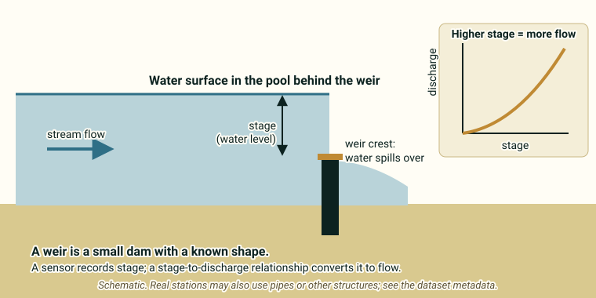

::: {.pager}
[Back to Hydrology](index.qmd)

[Next: Harvard Forest Hydrology →](harvard-forest-hydro.qmd)
:::

## What it is
Continuous daily streamflow records from nine small watersheds (12–77 ha) at the Hubbard Brook Experimental Forest in New Hampshire. One of the longest continuous watershed hydrology records in the United States.

## Explanation of data

**The big idea.** A **watershed** is all of the land that drains to one point on a stream, like a bowl that funnels rain to a single drain. This dataset records how much water leaves **nine small watersheds** (12–77 hectares each; a hectare is about the size of a soccer field) at the Hubbard Brook Experimental Forest in New Hampshire, every day since 1956. It is one of the longest watershed records in the United States.

**What is streamflow?** *Streamflow* (also called *discharge*) is how much water flows past a point on a stream. For small watersheds like these, flow is commonly measured at the **outlet** with a gauge on a small dam called a **weir**. A sensor records how high the water is (the *stage*), and that height is converted to flow. (The README does not describe the instruments in detail, so check the metadata.)

{fig-alt="Side view of a weir with an arrow for stage, and a small graph showing discharge rising with stage."}

**Units: mm/day.** The README gives streamflow in **millimeters per day**. That may look odd for a flow, but it is clever: it is the volume of water divided by the watershed's area, so it is the *depth* of water that would cover the whole watershed. That makes a 12-hectare watershed directly comparable with a 77-hectare one.

**The water budget.** Where does rain go? A watershed's water budget says: **P = Q + ET + ΔS**.

- **P (precipitation):** rain and snow that fall.
- **Q (streamflow):** water that leaves in the stream. This is the variable in this dataset.
- **ET (evapotranspiration):** water that returns to the air by evaporation and by *transpiration* (plants releasing water vapor through their leaves).
- **ΔS (change in storage):** the change in water held in soil, groundwater and snow.

Over many years, storage changes little, so rain is roughly split between streamflow and ET. *This dataset only has Q.* It does not include P or ET, so you need other data to close the budget.

{fig-alt="Cross-section of a watershed with arrows for precipitation, streamflow, evapotranspiration and storage, and the equation P equals Q plus ET plus change in storage."}

**Reference vs. experimental watersheds.** The README says some watersheds are *reference* (left alone, as a baseline) and some were *experimentally manipulated*. Its suggested analyses mention *deforestation experiments* such as clear-cutting. Trees pump a lot of water back to the air, so one idea you could test is whether cutting trees changes streamflow. Compare treated watersheds with reference watersheds, and look at the data rather than assuming the answer.

**A caution on the instruments.** The README notes a *transition from chart-recorder to digital sensors*. A change in equipment can change how data look, so check whether a jump in your data lines up with that transition.

::: {.callout-note appearance="simple"}
**Not stated in the README:** which watersheds are reference or treated, and when each treatment took place. Check the [metadata page](https://portal.edirepository.org/nis/mapbrowse?packageid=knb-lter-hbr.2.15).
:::

### Key terms

| Term | Plain-language meaning | Typical units |
|---|---|---|
| Watershed | All the land draining to one point on a stream | 12–77 ha here |
| Streamflow / discharge | Water flowing past a point in the stream | mm/day |
| Weir | A small dam with a known shape used to measure flow | n/a |
| Stage | Height of the water surface | Not given in README |
| Evapotranspiration (ET) | Water returned to the air by evaporation and plants | Not in this dataset |
| Water budget | Accounting of water in, out and stored: P = Q + ET + ΔS | n/a |
| Reference watershed | A watershed left undisturbed as a baseline | n/a |
| Experimental (manipulated) watershed | A watershed where researchers changed something, such as cutting trees | n/a |
| Chart recorder vs. digital sensor | Old paper-chart vs. electronic way of recording water level | n/a |

## Source and access

- **EDI package ID:** `knb-lter-hbr.2.15`
- **Metadata page:** [https://portal.edirepository.org/nis/mapbrowse?packageid=knb-lter-hbr.2.15](https://portal.edirepository.org/nis/mapbrowse?packageid=knb-lter-hbr.2.15)
- **DOI:** [https://doi.org/10.6073/pasta/355cda48aaf6764dd146990ab76a1a7b](https://doi.org/10.6073/pasta/355cda48aaf6764dd146990ab76a1a7b)
- **Original README:** [Hydrology_1_HubbardBrook_Streamflow_README.md](https://github.com/EAES-380/2026-Final-Project-Data-Options/blob/main/Hydrology_1_HubbardBrook_Streamflow_README.md)

::: {.callout-note appearance="simple"}
**Note on access (from the course README):** Most EDI datasets can be downloaded directly from the metadata page (or via the generated R/Python code). Some require a free EDI access key for scripted downloads. Check the “Accessing Data” documentation on the EDI site if you encounter authentication prompts.
:::

## Variables and contents
- Daily streamflow (mm/day) for multiple watersheds
- Includes both reference and experimentally manipulated watersheds
- Transition from chart-recorder to digital sensors documented

## Temporal & spatial coverage
- **Time:** 1956–2024 (and ongoing)
- **Location:** Hubbard Brook Experimental Forest, White Mountains, New Hampshire, USA

## Why this dataset is useful for final projects
Classic dataset for studying watershed hydrology, effects of forest management (e.g., clear-cutting experiments), and long-term hydrologic change. Well-documented and widely used in teaching.

## Suggested questions and analyses
- Effects of deforestation or other experiments on streamflow
- Long-term trends or variability in discharge
- Comparison among watersheds with different treatments or characteristics

## Using this dataset in your project

::: {.project-link}
Thinking about choosing this dataset? Your **proposal** needs a description of the data (what each row is, the variables and a data dictionary), a first exploratory figure, and one question with a possible method. The [Proposal page](../project-guide/proposal.qmd) has a one-page template, and the [Project guide](../project-guide/index.qmd) summarizes everything due. Before you commit, check that this dataset gives you at least 50 rows and at least 10 variables, including categorical, discrete numerical and continuous numerical variables, and that you can load it into R.
:::

---

::: {.pager}
[Back to Hydrology](index.qmd)

[Next: Harvard Forest Hydrology →](harvard-forest-hydro.qmd)
:::
