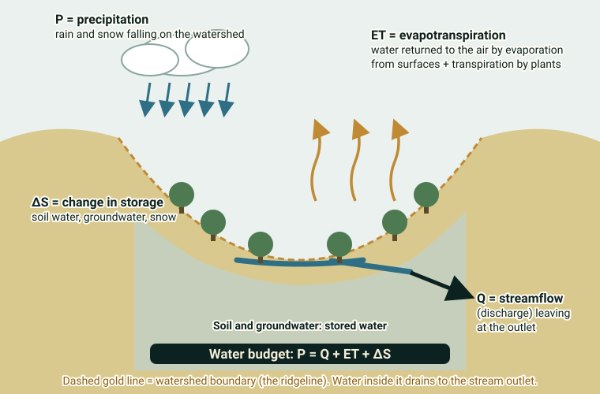

::: {.pager}
[← Previous: Harvard Forest Hydrology](harvard-forest-hydro.qmd)

[Back to Hydrology](index.qmd)
:::

## What it is
See the dedicated Biogeochemistry README for full details. MacroSheds provides harmonized daily discharge, chemistry, and watershed attributes for >200 small watersheds and is equally valuable for hydrology-focused projects.

## Explanation of data

This page covers the **same dataset** as the [Biogeochemistry MacroSheds page](../biogeochemistry/macrosheds.qmd), which has the full explanation of solutes, concentration and load. Here is the short version for a **water-focused** project.

**The big idea.** A **watershed** is all of the land that drains to one point on a stream. MacroSheds combines daily measurements from more than 200 small watersheds across the United States, with consistent formatting (*harmonized*) so you can compare them.

**What matters most for hydrology?**

- **Discharge (streamflow):** how much water flows past a point in the stream per unit of time (daily in this dataset).
- **Precipitation:** rain and snow falling on the watershed, where available.
- **Watershed attributes:** climate, geology, terrain, vegetation and land cover, which help explain why watersheds behave differently.

**Runoff generation.** The README suggests studying *controls on runoff generation*. *Runoff* is the part of precipitation that ends up in the stream. A watershed's **water budget** shows where rain goes: **P = Q + ET + ΔS**. Precipitation (P) leaves as streamflow (Q) and evapotranspiration (ET, water returned to the air by evaporation and plants), or is held back as a change in storage (ΔS, in soil, groundwater and snow). Comparing Q to P across watersheds, and relating that to attributes like climate, vegetation and terrain, is a natural project.

{fig-alt="Cross-section of a watershed with arrows for precipitation, streamflow, evapotranspiration and storage, and the equation P equals Q plus ET plus change in storage."}

**Integration with chemistry.** The dataset also has stream chemistry, so you can ask how flow and chemistry are linked. A **concentration** (dissolved amount per volume of water) combined with **discharge** gives a **load** (how much leaves per time). See the Biogeochemistry page for details.

::: {.callout-note appearance="simple"}
**Not stated in the README:** units, which sites have precipitation, and how long each record is. Check the [metadata page](https://portal.edirepository.org/nis/mapbrowse?packageid=edi.1262.2), the [dashboard](https://macrosheds.org) or the R package.
:::

### Key terms

| Term | Plain-language meaning | Typical units |
|---|---|---|
| Watershed | Land that drains to one point on a stream | n/a |
| Discharge | Volume of water passing a point in the stream per time | Not given in README (daily) |
| Precipitation | Rain and snow falling on the watershed | Not given in README |
| Runoff | The part of precipitation that ends up in the stream | n/a |
| Evapotranspiration (ET) | Water returned to the air by evaporation and plants | n/a |
| Water budget | P = Q + ET + ΔS | n/a |
| Watershed attributes | Descriptors of climate, geology, terrain, vegetation and land cover | Varies |
| Harmonized | Put into a common format so sites can be compared | n/a |

## Source and access

- **EDI package ID:** `edi.1262.2`
- **Metadata page:** [https://portal.edirepository.org/nis/mapbrowse?packageid=edi.1262.2](https://portal.edirepository.org/nis/mapbrowse?packageid=edi.1262.2)
- **DOI:** [https://doi.org/10.6073/pasta/5ffad974009ff64d0cfc2183c816790b](https://doi.org/10.6073/pasta/5ffad974009ff64d0cfc2183c816790b)
- **Full details:** [MacroSheds under Biogeochemistry](../biogeochemistry/macrosheds.qmd)
- **Original README:** [Hydrology_3_MacroSheds_README.md](https://github.com/EAES-380/2026-Final-Project-Data-Options/blob/main/Hydrology_3_MacroSheds_README.md)

::: {.callout-note appearance="simple"}
**Note on access (from the course README):** Most EDI datasets can be downloaded directly from the metadata page (or via the generated R/Python code). Some require a free EDI access key for scripted downloads. Check the “Accessing Data” documentation on the EDI site if you encounter authentication prompts.
:::

## Why useful for Hydrology & Ecosystems students
Enables multi-site comparative hydrology, examination of controls on runoff generation, and integration of hydrologic and biogeochemical data.

## Using this dataset in your project

::: {.project-link}
Thinking about choosing this dataset? Your **proposal** needs a description of the data (what each row is, the variables and a data dictionary), a first exploratory figure, and one question with a possible method. The [Proposal page](../project-guide/proposal.qmd) has a one-page template, and the [Project guide](../project-guide/index.qmd) summarizes everything due. Before you commit, check that this dataset gives you at least 50 rows and at least 10 variables, including categorical, discrete numerical and continuous numerical variables, and that you can load it into R.
:::

---

::: {.pager}
[← Previous: Harvard Forest Hydrology](harvard-forest-hydro.qmd)

[Back to Hydrology](index.qmd)
:::
