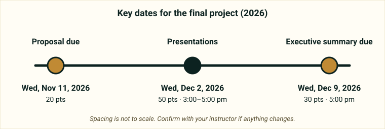
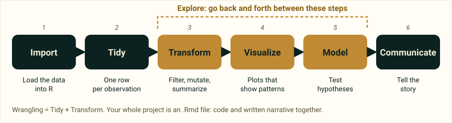

::: {.callout-note appearance="simple"}
This guide helps you get started. You will eventually work from your own **group repository** (graduate students may work independently), so treat this site as a map and your group repo as the place where the work lives. If anything here conflicts with what your instructor tells you, follow your instructor.
:::

## Key dates

{fig-alt="Timeline: proposal due Wednesday November 11 2026; final presentations Wednesday December 2 2026 from 3:00 to 5:00 pm; executive summary due Wednesday December 9 2026 at 5:00 pm."}

| Deliverable | Due | Points |
|---|---|---|
| [Proposal](proposal.qmd) | Wed, Nov 11, 2026 | 20 |
| [Presentation](presentation.qmd) | Wed, Dec 2, 2026, 3:00–5:00 pm | 50 |
| [Executive summary](executive-summary.qmd) | Wed, Dec 9, 2026, 5:00 pm | 30 |

<p style="font-size:.8rem;color:#5b5133;">Confirm with your instructor if anything changes.</p>

## At a glance

**In a nutshell:** pick a dataset, any dataset, and apply your data science workflow. Submit a proposal, give a 5-minute presentation (or share a pre-recording), and write up a README executive summary.

::: {.guide-tiles}
::: {.guide-tile}
### [Kick-off](kickoff.qmd)
Why we do the project, how it works, and the four first activities.
:::
::: {.guide-tile}
### [Proposal](proposal.qmd)
**20 pts.** About one page in R Markdown, with a copy-and-paste template.
:::
::: {.guide-tile}
### [Presentation](presentation.qmd)
**50 pts.** 5 minutes maximum, slides built with xaringan.
:::
::: {.guide-tile}
### [Executive summary](executive-summary.qmd)
**30 pts.** A brief write-up in your repo's README.
:::
:::

**Everyone** applies the data science skills from the course to a dataset of their choosing. Following the data science workflow, you will import, tidy and transform (wrangle), visualize and communicate your data. The last two units cover modeling, including hypothesis tests. The project includes text narrative explaining your code and thought process in an .Rmd file, just like all semester.

- **Undergraduates** choose a dataset as a group, based on interests.
- **Graduate students** can work independently (or collaborate) on their own datasets, and are graded the same as undergraduates even though the work may exceed class expectations.

## The data science workflow

{fig-alt="Six boxes in a row labeled Import, Tidy, Transform, Visualize, Model and Communicate. A dashed bracket over Transform, Visualize and Model marks a loop of exploration."}

Your project should walk through this cycle for a focused question. Use tidyverse packages in R and RStudio.

## Choosing a dataset

Pick a manageable dataset: readily accessible and large enough that multiple relationships can be explored.

- At least **50 observations (rows)** and at least **10 variables**.
- Variables should include **categorical**, **discrete numerical** and **continuous numerical** variables.
- If the data come in a format we have not met in class, make sure you can load it into R (this can be tricky). Ask for help before it is too late.
- Do **not** reuse datasets used in class examples, homework or labs.

The 12 options are on this site: start from the [home page](../index.qmd). You can also explore other sources, such as NASA, NOAA, WMO or Dryad, and graduate students may use their own project data.

## Grading

| Deliverable | Points |
|---|---|
| Proposal | 20 |
| Presentation | 50 |
| Executive summary | 30 |
| **Total** | **100** |

**Proposal breakdown (20 pts):** Data 6, Proposal 10, Workflow/organization/code quality 2, Teamwork 2. After feedback you can improve and re-submit. If you re-submit, your final proposal score is the average of the first and second submissions.

**Marking criteria** (how the whole project is assessed):

- **Content:** the quality of the research and/or policy question, and the relevance of the data to those questions.
- **Accuracy:** are statistical procedures carried out and explained correctly?
- **Writing and presentation:** the quality of the statistical presentation, writing and explanations.
- **Creativity and critical thought:** is the project carefully thought out, are limitations considered, and did time and effort go into planning and implementation?

## Repo organization

Your project repository should contain:

```
your-group-repo/
├── presentation.Rmd    # your slides (source)
├── presentation.html   # your slides (rendered)
├── README.Rmd          # your write-up (source)
├── README.md           # your write-up (rendered)
├── data/               # dataset (CSV or RDS) and data dictionary
└── proposal/           # the project proposal
```

Style and format count, so make sure everything looks good and the data and code are properly formatted.

## Tips

- You are working in the same repo as your teammates, so merge conflicts will happen and issues will arise, and that is fine. **Commit and push often**, and ask questions when stuck.
- Review the marking guidelines and ask questions if expectations are unclear.
- Make sure each team member contributes in quality and quantity. The instructor reviews commits by team member.
- Set aside time to work together and apart.
- When you are done, review the documents on GitHub to make sure you are happy with the final state.
- **Teamwork:** complete the assignment as a team. All members are expected to contribute equally, and team evaluations are given at the end. Anyone judged not to have contributed sufficiently will have their grade penalized.
- Every team member must understand how and why all of the code and approaches work.

## Deliverable pages

::: {.pager}
[Kick-off →](kickoff.qmd)

[Proposal →](proposal.qmd)

[Presentation →](presentation.qmd)

[Executive summary →](executive-summary.qmd)
:::
