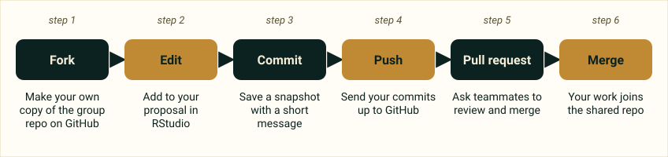

::: {.deadline}
::: {.deadline-title}
First deadline: Proposal
:::
::: {.deadline-date}
Due Wed, Nov 11, 2026
:::
Kick-off work is the start of your proposal (20 pts). Later dates are on the [Project guide](index.qmd).

::: {.deadline-small}
Confirm with your instructor if anything changes.
:::
:::

## Why?

- Mimic the project-based work and skills of a real data scientist.
- Apply your skills to a dataset of your choosing, including EAESy (earth and environmental science) data.
- Because this should be more useful (and fun?) than a big final exam.

## How?

1. **Pick a dataset** and apply the data science workflow.
2. **Conduct a focused (not exhaustive) analysis.** Demonstrate that you can ask a question and answer it with analysis results, code in R and combine code with text to produce .Rmd reports, and interpret and communicate results.
3. **Do whatever you want, but use tidyverse packages** in R and RStudio.
4. **Focus on quality, not quantity,** in code and results.
5. **Collaborate in small groups** (graduate students have an independent option).

## What?

Each group (or graduate student) will complete:

| Deliverable | Points | Format |
|---|---|---|
| [Proposal](proposal.qmd) | 20 | One page maximum, in R Markdown, describing (1) your dataset, (2) an exploratory visualization, and (3) one question you may pose and some tidyverse methods that may help answer it |
| [Presentation](presentation.qmd) | 50 | 5 minutes maximum, R Markdown with the xaringan package; each group member contributes 1–2 slides; tell the story of your analysis (what choices you made and why), not all the different things you tried |
| [Executive summary](executive-summary.qmd) | 30 | A brief summary of your project in the README of your GitHub repo; style and format matter, so make sure code and outputs look good |

Lab time is used for the projects. Groups form from shared interest and confidence level. Request and resolve any group changes early. Starter repos are released by your instructor at the proper kick-off.

## Kick-off activities

Work through these with your group:

- [ ] **1. Form groups.** Pick a group name, and include any remote classmates.
- [ ] **2. Pick a dataset with your instructor's help.** Choose from the options on this site or elsewhere (NASA, NOAA, WMO, Dryad, etc.), or from your own project (graduate students only). Discuss your options and interests as a group.
- [ ] **3. Self-organize.** How will you divide up the proposal? How, where and when will you meet outside class? Take 3 minutes to think about 5 "challenges" you might face during this project.
- [ ] **4. Start working on the proposal.** Fork the group repo and familiarize yourselves with the files. Add to your proposal, commit, push, create a pull request and merge. Your proposal needs a description of the dataset including a data dictionary, an exploratory visualization figure (with some narrative), and a question you could pose with a possible method for answering it.

## Git workflow in a group repo

{fig-alt="Six steps in a row: fork, edit, commit, push, pull request, merge."}

Commit and push often. Merge conflicts will happen when teammates edit the same lines; that is normal and expected.

::: {.pager}
[← Project guide](index.qmd)

[Next: Proposal →](proposal.qmd)
:::
